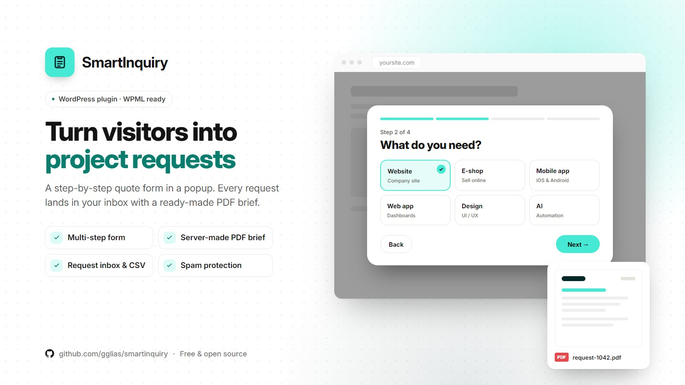

# SmartInquiry

A step-by-step quote request form in a popup for WordPress. Visitors pick a service, answer a few questions and download their request as a PDF. You get every request in the admin and by email. WPML ready.

> [!NOTE]
> **Comes with ready-made defaults.** These include a default PDF logo, a pre-filled list of agency services and budgets, the `#smartup-inquiry` link trigger and the `SU` reference prefix. Some of these can be changed in the settings. Others may not be changeable from the admin.
>
> **Need a white-label version?** Send me a message or email me at **[gglias.pro@gmail.com](mailto:gglias.pro@gmail.com)** and tell me what you need.

## Features

- **Multi-step form in a popup.**
  1. Pick a service.
  2. Answer that service's questions: single choice, multiple choice, "other" or free text.
  3. Choose a budget and timeline.
  4. Leave contact details and a preferred contact method.

  A live summary builds up as the visitor answers.
- **PDF brief.** Each request becomes a PDF with your logo, company details and footer. It is made on the server (GD + FreeType), with a browser fallback. The visitor can download it, it is attached to your notification email, and you can download it from the admin.
- **Request inbox in wp-admin.** Track status, add notes, use bulk actions, export to CSV, and get desktop notifications with sound when a new request arrives.
- **Your services and questions.** Edit the services, questions, texts and colors from the settings.
- **Roles.** Two extra roles, "Requests" and "Requests & settings", for team members who should only see the inbox.
- **Spam protection and privacy.**
  - Optional Cloudflare Turnstile.
  - Signed tokens and rate limiting on the REST endpoints.
  - Integration with WordPress's personal data export and erase tools.
  - Automatic clean-up of old requests.
- **WPML.** Greek and English included.

## Opening the form

Link to `#smartup-inquiry` from any button or menu item, or add the class `js-inquiry` to any element. You can also turn on the floating "Start a project" button in the settings.

## Requirements

- WordPress 6.1 or newer
- PHP 7.4 or newer
- The GD extension with FreeType, for server-side PDFs. Without it, the browser fallback is used.
- An SMTP plugin is recommended, so email notifications are delivered reliably.

## Installation

1. Download the latest `smartinquiry.zip` from [Releases](../../releases).
2. In WordPress go to **Plugins → Add New → Upload Plugin**, choose the zip and click **Install Now**.
3. Activate **SmartInquiry** and set your services, company details and colors in its settings.

Or clone this repository into `wp-content/plugins/smartinquiry`.

> [!IMPORTANT]
> The plugin doesn't update itself from WordPress.org. To update, download the new release and upload it again.

## Credits

- [Inter](https://rsms.me/inter/) font by Rasmus Andersson. SIL Open Font License 1.1, see `assets/fonts/Inter-LICENSE.txt`.
- Notification sound from [Kenney](https://kenney.nl) Interface Sounds. CC0, see `assets/sounds/Kenney-LICENSE.txt`.

## License

[GPL-2.0-or-later](LICENSE). Bundled assets keep their own licenses, listed above.

Made by **GG** · [Greg Glias](https://gglias.github.io)
